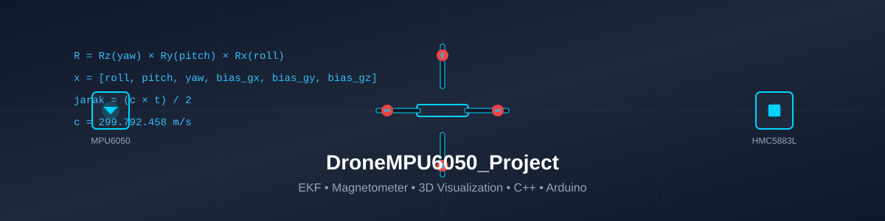

<p align="center">
  
</p>

<h1 align="center">🚁 DroneMPU6050_Project</h1>

<p align="center">
  <b>Sensor IMU Drone (MPU6050 + HMC5883L) dengan Extended Kalman Filter, Kalkulus, Vektor & Matriks, Analisis Akurasi & Presisi, dan Simulasi 3D</b>
</p>

<p align="center">
  <a href="https://www.arduino.cc/"></a>
  <a href="https://isocpp.org/"></a>
  <a href="https://www.python.org/"></a>
  <a href="https://threejs.org/"></a>
  <a href="https://opensource.org/licenses/MIT"></a>
</p>

---

## 📖 Deskripsi Project

Project ini adalah sistem monitoring dan estimasi attitudo drone (**roling, pitching, yawing**) berbasis **Arduino** dan **C++**, menggunakan sensor **9-DOF**:

| Sensor | Fungsi | Sumbu |
|--------|--------|-------|
| **MPU6050** | Accelerometer + Gyroscope | X, Y, Z |
| **HMC5883L** | Magnetometer (Kompas Digital) | X, Y, Z |

### ✅ Fitur Utama

| Fitur | Deskripsi |
|-------|-----------|
| **Extended Kalman Filter** | Estimasi attitude 6-state dengan kompensasi bias gyro |
| **Magnetometer** | Referensi yaw absolut (tilt-compensated heading) |
| **Kalkulus Numerik** | Integrasi trapezoidal & turunan numerik |
| **Matriks Rotasi 3×3** | Transformasi koordinat world ↔ body frame |
| **Analisis Akurasi & Presisi** | RMSE, Mean Error, Standard Deviation |
| **Kecepatan Cahaya (ToF)** | Simulasi jarak time-of-flight dengan *c = 299.792.458 m/s* |
| **Visualisasi 3D** | Simulasi drone di browser dengan Three.js |
| **Kalibrasi Otomatis** | Offset MPU6050 & hard/soft iron magnetometer |

---

## 🏗️ Arsitektur Sistem

```text
[ MPU6050 ] [ HMC5883L ]
     \         /
      \       /
   [ Arduino Uno/Nano/Mega ]
             |
          I2C / Serial
             |
     [ Python: serial_to_csv.py ]
             |
          drone_data.csv
             |
     [ C++ Host: main.cpp + EKF ]
             |
   [ Laporan Akurasi & Presisi ]
   [ Data Visualisasi 3D (JS) ]
             |
     [ Browser: drone_3d.html ]
```

---

## 🛠️ Hardware yang Diperlukan

| Komponen | Qty | Keterangan |
|----------|-----|------------|
| Arduino Uno / Nano / Mega | 1 | Mikrokontroler |
| MPU6050 (GY-521) | 1 | Accel + Gyro 6-DOF |
| HMC5883L | 1 | Magnetometer 3-DOF |
| Breadboard + Jumper | 1 set | Perambangan |
| Laptop/PC | 1 | Untuk C++ host & browser |

### Pinout (Arduino Uno/Nano)

| Sensor | Pin | Arduino |
|--------|-----|---------|
| MPU6050 VCC | 5V | 5V |
| MPU6050 GND | GND | GND |
| MPU6050 SCL | SCL | A5 |
| MPU6050 SDA | SDA | A4 |
| HMC5883L VCC | 5V | 5V |
| HMC5883L GND | GND | GND |
| HMC5883L SCL | SCL | A5 |
| HMC5883L SDA | SDA | A4 |

> Kedua sensor berbagi bus I2C yang sama (A4/A5).

---

## 🚀 Cara Penggunaan

### 1. Clone Repository

```bash
git clone https://github.com/101manparta/DroneMPU6050_Project.git
cd DroneMPU6050_Project
```

### 2. Upload Sketch ke Arduino

1. Buka **Arduino IDE**
2. Buka file: `arduino/MPU6050_Drone_EKF.ino`
3. Pilih Board & Port yang sesuai
4. Klik **Upload**
5. Buka **Serial Monitor** (baud 115200)
6. Tunggu kalibrasi selesai, lalu putar drone untuk kalibrasi magnetometer

Format output CSV:
```
timestamp_ms,roll,pitch,yaw,ax,ay,az,gx,gy,gz,mx,my,mz,temp_c,heading_tilt_comp
```

### 3. Simpan Data ke CSV

**Menggunakan Python bridge:**

```bash
# Install dependency
pip install pyserial

# Windows
python python/serial_to_csv.py --port COM3 --baud 115200 --output drone_data.csv --duration 60

# Linux/macOS
python python/serial_to_csv.py --port /dev/ttyACM0 --baud 115200 --output drone_data.csv --duration 60
```

### 4. Kompilasi & Jalankan C++ Host

```bash
# Windows (MinGW g++)
g++ -std=c++11 -O2 cpp_host/main.cpp -o drone_analyzer.exe
drone_analyzer.exe drone_data.csv output_3d.js

# Linux / macOS
g++ -std=c++11 -O2 cpp_host/main.cpp -o drone_analyzer
./drone_analyzer drone_data.csv output_3d.js
```

### 5. Visualisasi 3D di Browser

1. Salin `cpp_host/drone_3d.html` dan `output_3d.js` ke satu folder
2. Buka `drone_3d.html` di browser (Chrome/Firefox/Edge)
3. Klik **▶ Play** untuk memutar animasi drone sesuai data riil

---

## 📐 Matematika yang Digunakan

| Topik | Implementasi |
|-------|--------------|
| **EKF** | Extended Kalman Filter 6-state: `[roll, pitch, yaw, bias_gx, bias_gy, bias_gz]` |
| **Kalkulus** | Integrasi trapezoidal (gyro → sudut), turunan numerik (accel → rate) |
| **Vektor** | Vektor gravitasi, dot product, cross product, normalisasi |
| **Matriks** | Matriks rotasi 3×3 (Rx, Ry, Rz), transformasi world → body |
| **Magnetometer** | Tilt-compensated heading, kalibrasi hard iron & soft iron |
| **Akurasi** | Mean Error vs nilai referensi (ground truth) |
| **Presisi** | Standard Deviation, Variance |
| **Kecepatan Cahaya** | `jarak = (c × t) / 2` untuk simulasi Time-of-Flight |

### Matriks Rotasi Lengkap

$$R = R_z(\text{yaw}) \times R_y(\text{pitch}) \times R_x(\text{roll})$$

---

## 📊 Contoh Output Laporan

```
============================================================
              EKF — HASIL ESTIMASI ATTITUDE                 
============================================================

--- ROLL (EKF) ---
Samples        : 3600
Mean Error     : 0.1234 deg (Akurasi)
RMSE           : 0.4567 deg
Std Dev        : 0.3210 deg (Presisi)

--- PITCH (EKF) ---
Samples        : 3600
Mean Error     : 0.0987 deg (Akurasi)
RMSE           : 0.3821 deg
Std Dev        : 0.2845 deg (Presisi)

--- YAW (EKF) ---
Samples        : 3600
Mean Error     : 0.1543 deg (Akurasi)
RMSE           : 0.5123 deg
Std Dev        : 0.4102 deg (Presisi)

--- Estimasi Bias Gyro (EKF) ---
Bias X: 0.0045 deg/s
Bias Y: -0.0023 deg/s
Bias Z: 0.0011 deg/s

--- KECEPATAN CAHAYA (ToF 100ns) ---
Jarak estimasi drone-ke-target : 14.9896 meter
```

---

## 📂 Struktur Folder

```
DroneMPU6050_Project/
├── arduino/
│   ├── MPU6050_Drone_EKF.ino    # Sketch Arduino (9-DOF + CSV output)
│   └── MPU6050_Drone.ino        # Versi dasar (6-DOF, tanpa magnetometer)
├── cpp_host/
│   ├── main.cpp                 # Program analisis C++ (EKF, statistik, kalkulus)
│   ├── ekf.h                    # Extended Kalman Filter (6-state)
│   ├── matrix.h                 # Matriks 3x3, vektor 3D, rotasi
│   ├── statistics.h             # Statistik akurasi & presisi, kalkulus numerik
│   ├── magnetometer.h           # Kalibrasi magnetometer & heading
│   ├── drone_3d_viz.cpp         # Generator data visualisasi 3D (CSV → JS)
│   └── drone_3d.html            # Simulasi drone 3D di browser (Three.js)
├── python/
│   ├── serial_to_csv.py         # Bridge serial Arduino → CSV
│   └── plot_attitude.py         # Plotting grafik attitudo (matplotlib)
├── docs/
│   ├── CALIBRATION.md           # Panduan kalibrasi sensor
│   ├── EKF_GUIDE.md             # Panduan Extended Kalman Filter
│   └── LIMITATIONS.md           # Batasan project (jujur tentang akurasi)
├── .github/
│   └── ISSUE_TEMPLATE/
│       ├── bug_report.md
│       └── feature_request.md
├── CONTRIBUTING.md              # Pedoman kontribusi
├── LICENSE                      # Lisensi MIT
├── README.md                    # Dokumentasi ini
├── banner.svg                   # Banner project
└── .gitignore                   # File yang diabaikan Git
```

---

## ⚠️ Penting: Mengenai Akurasi

**Akurasi 100% tidak mungkin** dengan sensor MPU6050 kelas konsumen karena:
1. **Gyro drift** – Error menyelimut saat integrasi waktu berlangsung
2. **Noise accelerometer** – Sensitif terhadap getaran dan suhu
3. **Tanpa GPS/Barometer** – Tidak ada referensi navigasi eksternal

Project ini dirancang untuk **pembelajaran, prototipe, dan uji coba konsep**, bukan untuk penerbangan autonom nyata tanpa penambahan sensor dan filter yang lebih canggih. Lihat `docs/LIMITATIONS.md` untuk detailnya.

---

## 🤝 Kontribusi

Kontribusi sangat diterima! Silakan baca `CONTRIBUTING.md` untuk pedoman berkontribusi.

1. Fork repository ini
2. Buat branch fitur: `git checkout -b fitur/nama-fitur`
3. Commit perubahan: `git commit -m "Menambahkan fitur XYZ"`
4. Push: `git push origin fitur/nama-fitur`
5. Buka Pull Request

---

## 📄 Lisensi

Project ini didistribusikan di bawah lisensi **MIT**. Lihat file `LICENSE` untuk detail lengkap.

---

## 👤 Author

**101manparta**  
GitHub: [https://github.com/101manparta](https://github.com/101manparta)

---

⭐ **Jika project ini bermanfaat, jangan lupa memberikan star pada repository ini!**
